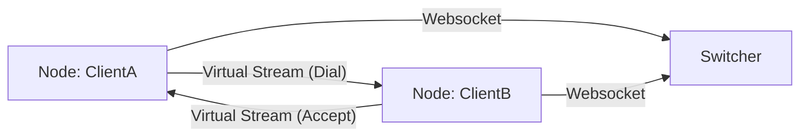

# FLEX - Reliable Multiplexing Network Library

`flex` is a high-performance, improved stream multiplexing library built on top of reliable connections (TCP, WebSocket). It abstracts complex network interactions into simple `Node`, `Switcher`, and `Stream` concepts, allowing developers to build complex peer-to-peer or relay networks with ease.

[](https://codecov.io/gh/net-agent/flex)

## Key Features

-   **Stream Multiplexing**: Run practically unlimited logical streams over a single physical connection (e.g., TCP, WebSocket).
-   **Node & Switcher Architecture**:
    -   **Node**: Acts as a client or agent. Can Dial or Listen on virtual ports.
    -   **Switcher**: Acts as a relay server. Routes traffic between Nodes using virtual domains and IPs.
-   **Session with Auto-Reconnect**: `node.Session` wraps a Node with lazy connect, automatic reconnection with backoff, and listeners that survive reconnects.
-   **Presence Subscription**: `Node.Watch()` subscribes to named nodes' online/offline states; the Switcher pushes change events in real time (the subscribe ACK carries a state snapshot, seamlessly stitched with later events), replacing `PingDomain` polling.
-   **Fair Scheduling**: Built-in **Fair Queuing** (see `internal/sched`). The default **cost-budget** policy charges each packet `max(payload, 1KB)` against a 32KB per-visit budget, so a 1-byte stream cannot monopolize the link while ACKs/Pings keep flowing. The historical packet quantum (`quantum=2`) remains available via `SetSchedulerConfig`. Enabled by default on both `switcher.Server` and `node.Session`.
-   **Inspection APIs**: `Node.GetInfo()` / `Node.GetListeners()`, `Switcher.GetStats()` / `Switcher.GetClients()`, and `Stream.GetState()` expose traffic counters, active streams, and RTT in real time.
-   **Backpressure that fails loud**: the receive queue is bounded by bytes (matching the flow-control window), never blocks the dispatcher, and reports a protocol violation by actively closing the stream instead of silently dropping data.
-   **Admission control**: connection/stream/subscription quotas, per-IP handshake rate limiting and source-address validation are enabled with generous defaults on `switcher.Server` (see `SetLimits`).
-   **Reliability**: Robust connection management with heartbeat keep-alive and active/passive close handling.

## Architecture



## Scheduling

`switcher.Server` and `node.Session` wrap managed connections in a `FairConn`.
The default is **cost-budget (B)**: each packet is charged
`max(payload, MinChargeBytes)` against `QuantumBytes` (defaults: 32KB / 1KB),
which caps a visit at 32 packets even for 1-byte payloads.

```go
// Default (B): cost-budget, 32KB per visit, 1KB minimum charge per packet.
srv := switcher.NewServer(password, nil, nil)

// Switch back to the historical packet quantum (C).
srv.SetSchedulerConfig(switcher.SchedulerConfig{
    Policy:         switcher.SchedulerPolicyPackets,
    QuantumPackets: 2,
})
```

Use `node.Session.SetSchedulerConfig` for the client side. See
[Fairness & Scheduling](docs/manual.md#fairness--scheduling) for the trade-offs.

## Quick Start

### Installation

```bash
go get github.com/net-agent/flex/v3
```

### 1. Minimal Node-to-Node (Direct Mode)

You can use `flex` to multiplex any `net.Conn`. In direct mode both sides set their own domain and virtual IP manually:

```go
// Server side
server := node.New(packet.NewWithConn(srvConn))
server.SetDomain("server-node")
server.SetIP(1)
go server.Serve()

ln, _ := server.Listen(80)
conn, _ := ln.Accept() // conn is a *stream.Stream and implements net.Conn
```

```go
// Client side
client := node.New(packet.NewWithConn(conn))
client.SetDomain("client-node")
client.SetIP(2)
go client.Serve()

s, err := client.Dial("server-node:80") // or client.DialIP(1, 80)
if err != nil {
    log.Fatal(err)
}
s.Write([]byte("Hello"))
```

### 2. Using Switcher (Relay Mode)

The Switcher authenticates nodes with a password, assigns virtual IPs, and routes packets between domains:

```go
// Start the Switcher
srv := switcher.NewServer("password", nil, nil)
ln, _ := net.Listen("tcp", ":8080")
log.Fatal(srv.Serve(ln))
```

Nodes join the network with `node.Connect`, which performs the authenticated handshake and returns a ready-to-serve Node:

```go
conn, _ := net.Dial("tcp", "127.0.0.1:8080")
n, err := node.Connect(packet.NewWithConn(conn), "client-a", "", "password")
if err != nil {
    log.Fatal(err)
}
go n.Serve()

// Dial another node by domain
s, err := n.Dial("client-b:80")
```

See [examples/ws-gate](examples/ws-gate/main.go) for running a Switcher over WebSocket.

### 3. Session (Auto-Reconnect)

`node.Session` keeps the logical node alive across network failures: it reconnects with exponential backoff and re-registers all listeners after each reconnect.

```go
sess := node.NewSession(func() (packet.Conn, error) {
    conn, err := net.Dial("tcp", "127.0.0.1:8080")
    if err != nil {
        return nil, err
    }
    return packet.NewWithConn(conn), nil
}, node.SessionConfig{Domain: "client-a", Password: "password"})
go sess.Serve()

// The first Listen/Dial/Watch/PingDomain triggers the connection (lazy connect);
// during cold start these calls wait for the initial connect to complete
// (SetConnectTimeout, default 15s);
// the listener is restored automatically after every reconnect.
ln, err := sess.Listen(80)
```

## Examples

| Example | Description |
| --- | --- |
| [examples/echo](examples/echo/main.go) | Basic Switcher + two Nodes, echo over a virtual stream |
| [examples/ping](examples/ping/main.go) | RTT between nodes via `PingDomain` |
| [examples/presence](examples/presence/main.go) | Subscribe to node online/offline events via `Watch` |
| [examples/tcp-proxy](examples/tcp-proxy/main.go) | TCP port forwarding through the flex network |
| [examples/ws-gate](examples/ws-gate/main.go) | Switcher gateway over WebSocket |
| [examples/web-client](examples/web-client) | Browser demo (Vue) talking flex over WebSocket |

## Documentation

For detailed usage, configuration, and API reference, please see the **[Developer Manual](docs/manual.md)**.

- **[FairConn scheduling visualizer](docs/fairconn_visualizer.html)** — a self-contained interactive page: write-path architecture, live scheduling simulation, and a side-by-side comparison of the C/A/B policies.

## Inspection APIs

Both Node and Switcher expose their runtime state programmatically:

```go
info := n.GetInfo()         // node domain, IP, network, uptime, bytes read/written
listeners := n.GetListeners()

running := n.IsRunning()    // whether the node's dispatcher is serving
snap := n.Inspect()         // consistent snapshot: info, listeners, streams,
                            // port pools, pending requests, heartbeat state
                            // (incl. last RTT), cumulative failure counters

rates := snap2.RatesSince(snap1) // per-second rates between two snapshots
                                 // (node-level and per-stream)

closed, pos := n.GetClosedStates(pos) // incremental pull of closed-stream
                                      // records (ring buffer, latest 1024;
                                      // written when retention expires)

n.SetTrace(&node.Trace{     // lifecycle hooks (nil fields are disabled);
    StreamOpen:    func(st *stream.State) { /* ... */ }, // call before Serve
    StreamClosed:  func(st *stream.State) { /* ... */ }, // fires at detach (both directions closed)
    HeartbeatFail: func(err error) { /* ... */ },
    PortExhausted: func(pool string, err error) { /* ... */ },
})

stats := srv.GetStats()     // switcher active connections, total contexts, uptime
clients := srv.GetClients() // online nodes: domain, IP, stream count, bytes, RTT
```

Session exposes its connection lifecycle via `GetState()`, `GetLastErr()`, `GetReconnectCount()` and `OnStateChange()`, and provides `SetLogger`/`SetTrace`, which are automatically injected into every Node rebuilt across reconnects. See the [Developer Manual](docs/manual.md#observability) for details.

## Security & Limits

`flex` encrypts the admission handshake only; stream data is plain text. Treat it
as a multiplexing/relay layer, not a VPN: wrap the transport with TLS
(`tls.Listener` / `tls.Dial`, or `wss://`) on any untrusted network.

The Switcher rejects connections, streams and presence subscriptions beyond
`switcher.Limits` (configurable via `SetLimits`), rate-limits handshakes per IP,
and drops packets whose source address differs from the authenticated node.
See [Deployment & Security](docs/manual.md#deployment--security) for details.

## License

MIT, see [LICENSE](LICENSE).
